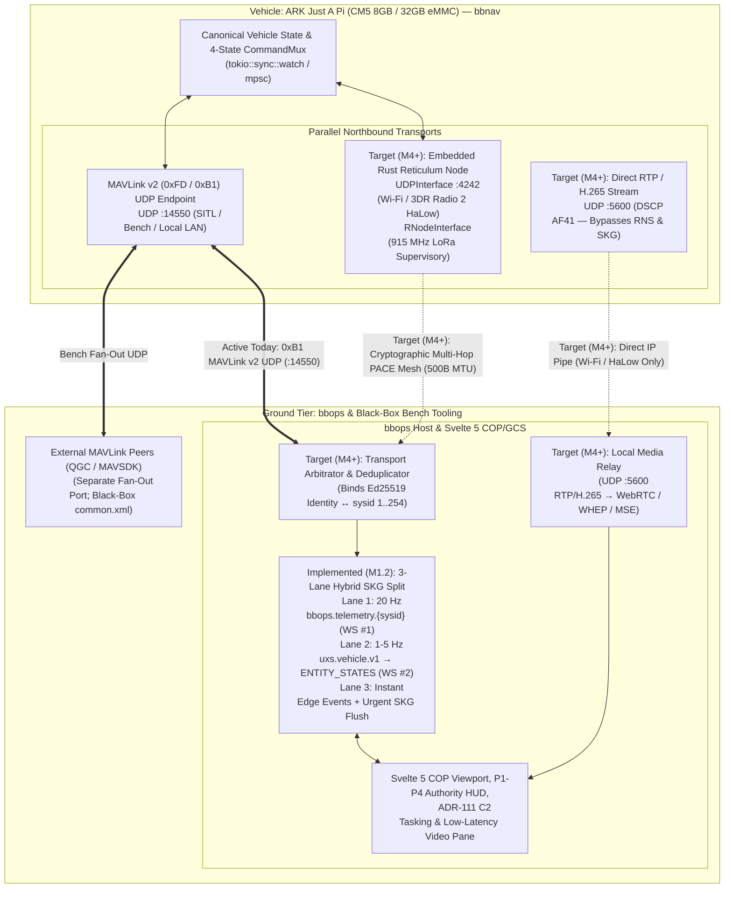

# `bbops` Dual-Stack Comms Topology: Reticulum + MAVLink v2 (`0xB1`) UDP

`bbops` serves as both the **Engineering / Tactical Ground Control Station (GCS)** and **Multi-Domain Common Operating Picture (COP)** for `Quadcopter`, `Rover`, and `SurfaceBoat` vehicles. To balance zero-friction bench/SITL bring-up with contested and HADR field survivability, `bbnav` (`boxbotix/bbstack`, running on the 8 GB / 32 GB RPi CM5 companion or local `bbsim` SITL) and `bbops` divide northbound traffic across **parallel transport pipelines**.

> [!IMPORTANT]
> **Implementation Status (`M1`–`M3` Baseline vs. `M4+` Target Architecture)**
> - **Active on `main` (`M1`–`M2`) & Next (`M3.1` / `#11`):** Clean-room MAVLink v2 (`0xFD`) `0xB1` `common.xml` UDP ingest (`127.0.0.1:14550` default), the 3-lane SemEngine SKG + dual-WebSocket COP pipeline (`internal/mavcodec`, `internal/mavlink`, `internal/uxsvocab`, `ui/`), and `M3.1` symmetric UDP actuation (`#76 COMMAND_LONG` / `#77 COMMAND_ACK` + `300 ms`-deadman `#84 SET_POSITION_TARGET_LOCAL_NED`).
> - **Target Architecture (`M4+`, gated on future OpenSpec `design`-track changes):** Embedded Reticulum mesh transport (`RNS` `:4242` / `RNode` 915 MHz LoRa), upstream *Transport Arbitrator & Deduplicator* (`Ed25519` ↔ `sysid` binding ahead of the 3-lane publisher), and local RTP/H.265 (`:5600`) → WebRTC/WHEP/MSE browser media relay (`#18` `M4.3` covers `<video>` WebGL sensor optics shaders).

---

## 1. Dual-Protocol Dataflow (`bbnav` ↔ `bbops`)

---

## 2. Protocol Responsibilities & Traffic Rules

| Traffic Class | MAVLink v2 (`0xB1`) over UDP (`:14550`) | Reticulum Mesh (`RNS` `:4242` / LoRa — *Target `M4+`*) | Why Both Exist |
| :--- | :--- | :--- | :--- |
| **Primary Environment & `0xB1` `LinkTier`** | `sitl-local` (`bbsim`) and `direct-bench` (`127.0.0.1:14550` default; `-bind-host 0.0.0.0` for local 5 GHz Wi-Fi pad checks), plus black-box 3rd-party `common.xml` bench tooling on a separate UDP fan-out port. | Field operations, multi-hop relays, and BVLOS PACE failover across Wi-Fi / `3DR Radio 2` HaLow (`mesh-high-rate`) and US915 LoRa `RNode` (`mesh-supervisory`). | Standard `common.xml` MAVLink v2 gives instant SITL/bench tooling on day 1; Reticulum survives non-IP, multi-hop, 500-byte MTU sub-GHz hops where UDP/IP drops. |
| **Vehicle Identity & Addressing** | Ephemeral `netip.AddrPort` + `sysid` (`1..=254`, `compid = 1`), materialized as ADR-102 6-part entity ID `<org>.<platform>.robotics.uxs.vehicle.<sysid>`. | Persistent **Ed25519/X25519 Destination Hash** (survives physical interface switches automatically). | Upstream `M4+` arbitration maps `Ed25519` identity ↔ `sysid` ahead of the 3-lane publisher so dual-connected bench/field nodes neither render twice on the COP nor flap `LinkTier` or outbound TX routing. |
| **High-Rate Attitude & Kinematics** | `20–50 Hz` `#31 ATTITUDE_QUATERNION`, `#32 LOCAL_POSITION_NED`, `#33 GLOBAL_POSITION_INT`, and `#1 SYS_STATUS` (`20 Hz` Lane 1 WS #1, `1–5 Hz` Lane 2 SKG, instant Lane 3 edges). | Pace-adapted: `10–30 Hz` unacknowledged `RNS.Packet` on Wi-Fi/HaLow (`mesh-high-rate`); `0.2–1 Hz` compact binary state deltas on US915 LoRa (`mesh-supervisory`). | Prevents Reticulum X25519/Ed25519 framing and 500-byte MTU queues from choking narrowband sub-GHz radios while keeping body-to-NED quaternion semantics identical across transports. |
| **Teleop Leases & Discrete C2 (`M3.1`+)** | `10–30 Hz` `#84 SET_POSITION_TARGET_LOCAL_NED` velocity + `yaw_rate` (`300 ms` deadman lease) and ADR-111 non-retrying `#76 COMMAND_LONG` / `#77 COMMAND_ACK` (`#69 MANUAL_CONTROL` is excluded). | `10–30 Hz` velocity setpoints (`teleop-velocity`) on Wi-Fi/HaLow (`mesh-high-rate`); on US915 LoRa (`mesh-supervisory`, `1 Hz`) cutover, `bbnav` clamps `teleop_deadman_clamped = true` and accepts only discrete non-retrying supervisory commands / waypoint nudges. | Spring-centered controller sticks always command **velocity** (`0,0` = active hover/station-keep), never raw Acro thrust over IP/mesh, and a `1 Hz` LoRa link cannot safely sustain a `300 ms` deadman velocity lease. |
| **Real-Time Video** | Never inside MAVLink. | **Never inside Reticulum** (500-byte MTU fragmentation and crypto overhead induce severe latency/jitter). | Video rides direct RTP/H.265 over UDP (`:5600`) on Wi-Fi/HaLow with Linux `tc` QoS (`DSCP EF` for C2, `AF41` for video), bridges into browser `COP_UI` via a local WebRTC/WHEP/MSE media relay (`#18`), and hard-stops on LoRa cutover. |

---

## 3. `bbops` Architectural Guardrails & Spec Invariants

1. **Sealed 9-Message `0xB1` `common.xml` Contract (`internal/mavcodec`, `PROVENANCE.md`):**
   `bbops` restricts its MAVLink v2 (`0xFD`) wire surface strictly to MIT `minimal.xml` + `common.xml` message IDs `#0 HEARTBEAT` (`[31:24] = 0xB1`, `MAV_AUTOPILOT_GENERIC = 0`), `#1 SYS_STATUS`, `#31 ATTITUDE_QUATERNION`, `#32 LOCAL_POSITION_NED`, `#33 GLOBAL_POSITION_INT`, `#76 COMMAND_LONG`, `#77 COMMAND_ACK`, `#84 SET_POSITION_TARGET_LOCAL_NED`, and `#253 STATUSTEXT`. Legacy Euler `#30 ATTITUDE`, `#69 MANUAL_CONTROL`, `ardupilotmega.xml`, and all Tier-3 GPLv3 flight-stack sources remain strictly prohibited.
2. **Loopback Default & Black-Box Bench Tooling (`configs/bbops.json`, `internal/mavlink`):**
   `bbops` binds `127.0.0.1:14550` by default (use `-bind-host 0.0.0.0` for direct LAN UDP or `-mavlink-udp-port` for port overrides) and drops `MAV_TYPE_GCS = 6` / `custom_mode = 0` peer heartbeats (`sysid = 255`) without creating bogus SKG entities. Co-running QGroundControl or MAVSDK on the same host requires `bbnav` / `bbsim` to fan out onto a separate UDP port, treating external tools strictly as black-box `common.xml` peers (`MAV_AUTOPILOT_GENERIC`).
3. **Arbitration Upstream of the Constant 22-Predicate SKG Profile (`openspec/specs/mavlink-ingest/spec.md`):**
   `uxs.vehicle.v1` (`VehicleSnapshot`) emits a locked constant 22-predicate `signal` triple set (`IndexingProfileSignal`) so `graph-index` skips `PREDICATE_INDEX` rewrites after entity creation, and `ui/src/lib/stores/telemetry.svelte.ts` drops out-of-order frames per `sysid` using monotonic host-arrival timestamps. When `M4+` Reticulum ingest lands, dual-link deduplication, active-link `peerAddr` selection, and `Ed25519` ↔ `sysid` identity binding MUST sit upstream of the 3-lane publisher (and go through an OpenSpec `design`-track proposal if `uxs.*` predicates change).
4. **Clean-Room Reticulum & Media Relay Provenance (`PROVENANCE.md`):**
   `C360Studio/semlink` (*pre-Reticulum meshing*) and `C360Studio/semops` are retired Tier-2 repositories and MUST NOT be imported. Any `M4+` Go Reticulum transport package, `rnsd`/Rust companion IPC bridge, or local WebRTC/WHEP/MSE video relay must be cleared under `PROVENANCE.md` Tier 1 (permissive MIT / Apache-2.0 / BSD) and recorded in `THIRD_PARTY_NOTICES` prior to implementation.
